## UIII act 4 Datos Pandas 
## Inversiones en bolsa -- Ramirez Azul NC 0441 NL 47

## Tabla original de inversiones en bolsa
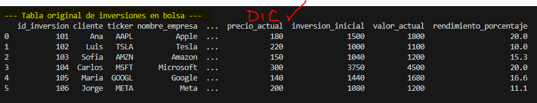
## 7. Convertir el DataFrame en archivo CSV
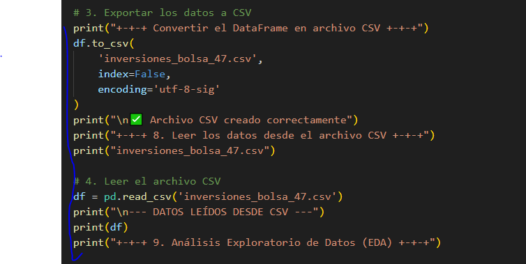
## Datos de CSV --> base de datos
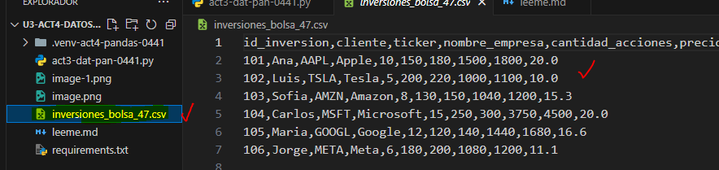
## 8. Leer los datos desde el archivo CSV
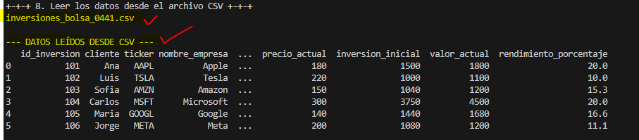
## 9. Análisis Exploratorio de Datos (EDA)

### Primeros y últimos registros
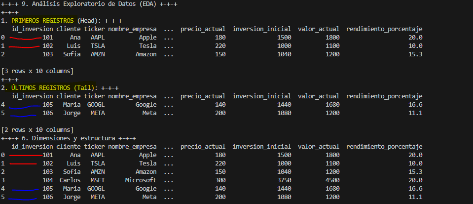
## 6. Dimensiones y estructura
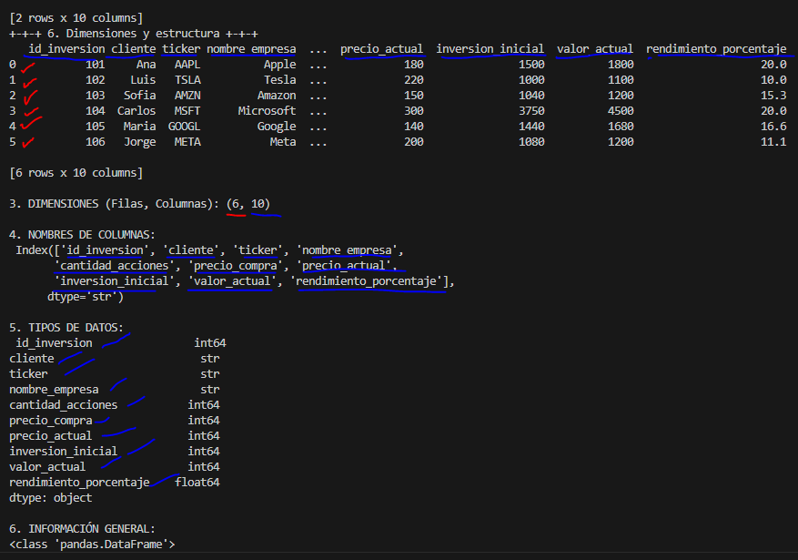
## 7. Estadísticas y limpieza
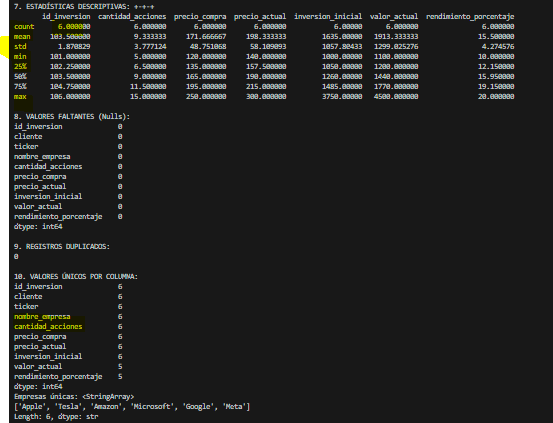
## 8 y 9. Ordenamiento, filtrado y agrupación
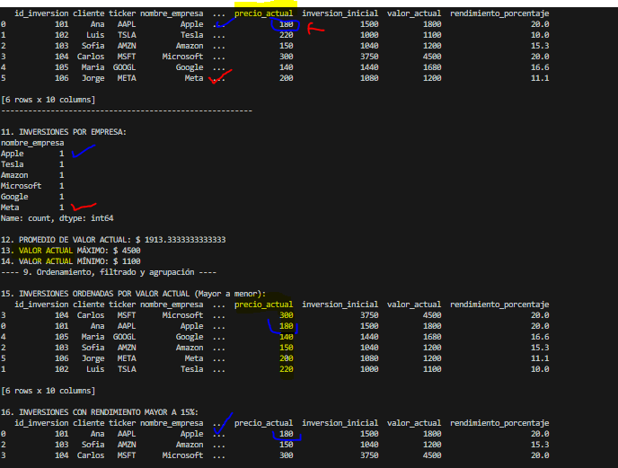
## 18. Gráfica de barras: Cantidad de acciones adquiridas por empresa
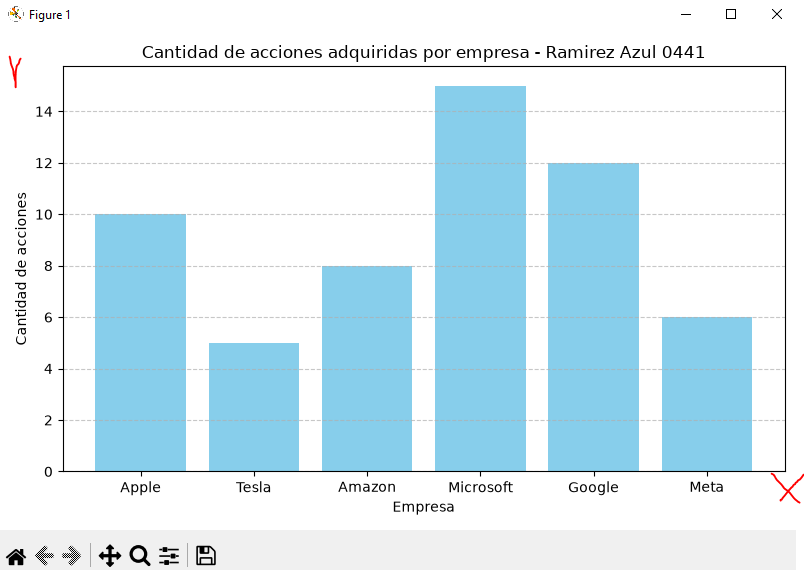
## 19. Gráfica de barras: Valor actual de inversión por cliente
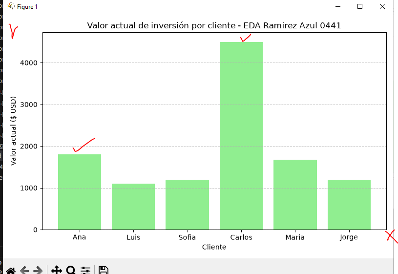
## 20. Histograma: Distribución de rendimientos porcentuales
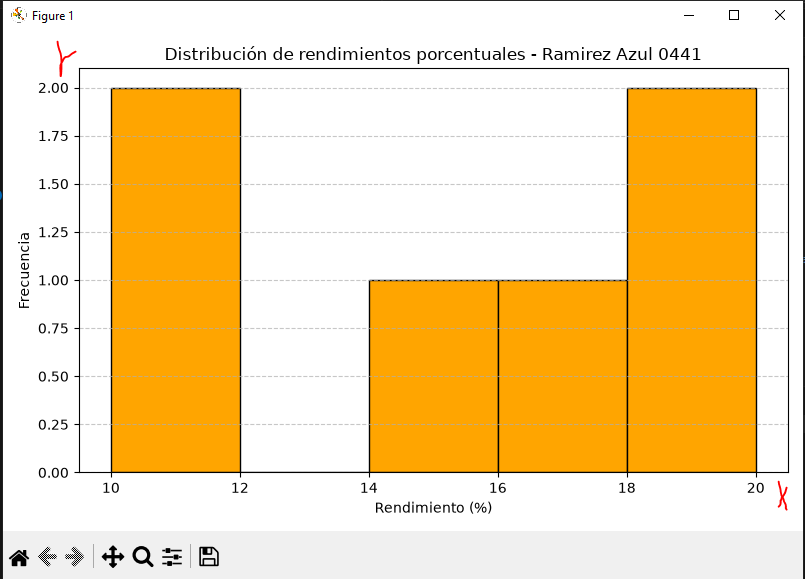
## 21. Gráfica de dispersión: Relación entre inversión inicial y valor actual
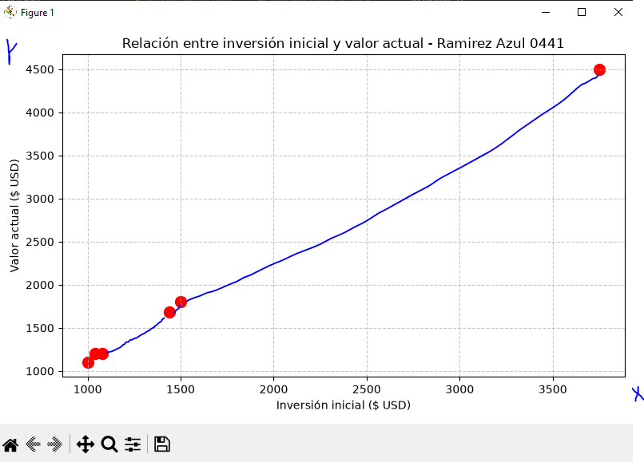
## 22. Diagrama de caja: Distribución de valores actuales
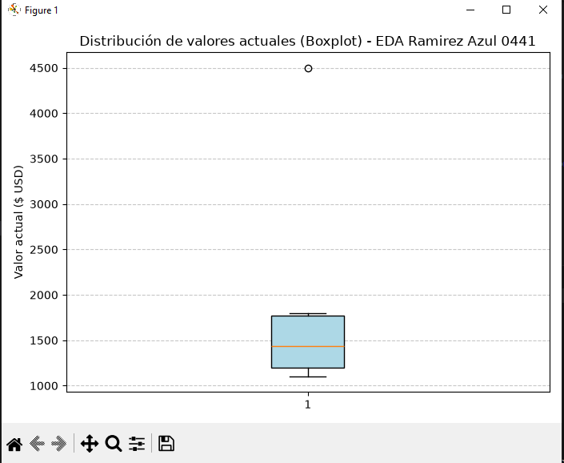
## 23. Matriz de correlación de variables numéricas
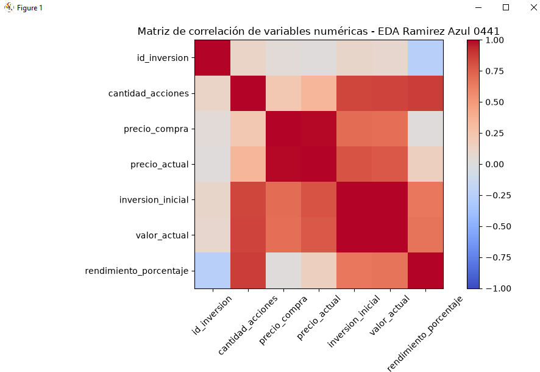